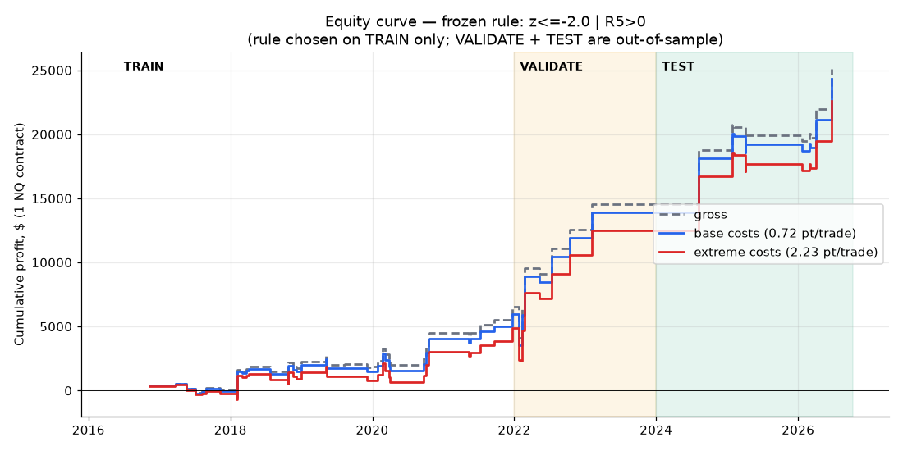
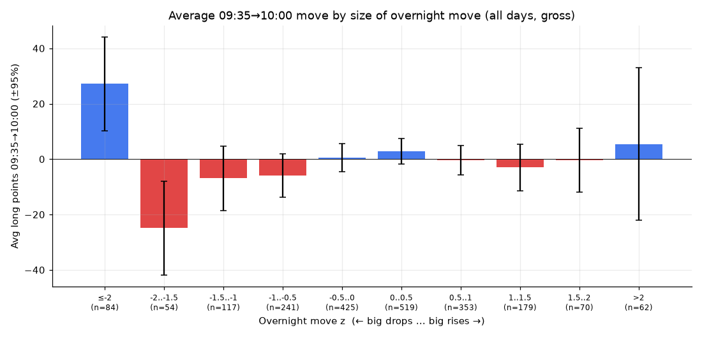

# NQ Post-Open Rebound After Extreme Overnight Drops


A quantitative research study on **Nasdaq-100 E-mini futures (NQ)**. It asks one question:

> After a **very large overnight drop**, does NQ rebound between **09:35 and 10:00 New York time**, and is the rebound big enough to cover trading costs?

The study uses 10 years of intraday data (2016 → 2026). The trading rule was **pre-registered**: it was chosen on a training period only and then tested on two later periods that were not used for the choice.

**→ Start with the notebook: [`NQ_PostOpen_Rebound.ipynb`](NQ_PostOpen_Rebound.ipynb)**. It covers every step, from data validation to the conclusion, and explains each one in plain language.

---

## Key results

| Period | Role | Trades | Avg. gross (pts) | Avg. net, base costs (pts) | t-stat (net) | Win rate |
|---|---|---:|---:|---:|---:|---:|
| 2016-08 → 2021-12 | **Train** (rule chosen here) | 38 | +8.61 | +7.89 | 1.86 | 58% |
| 2022 → 2023 | **Validate** (out of sample) | 8 | +50.00 | +49.28 | 1.54 | 63% |
| 2024 → 2026-10 | **Test** (out of sample) | 10 | +52.88 | +52.15 | 1.87 | 60% |
| **2022 → 2026-10** | **All out of sample** | **18** | **+51.60** | **+50.87** | **2.49** (p ≈ 0.01) | **61%** |

1 NQ point = $20 per contract. Base cost = 1 tick slippage per side + $4.50 fees = **0.725 pt per round trip**.



**Verdict: promising but not proven.** The out-of-sample result is statistically significant at the 5% level. It rests on only 18 trades, though, and several warning signs are reported openly below.

---

## The rule (frozen 2026-10-14)

| Step | Definition (New York time) |
|---|---|
| Overnight return | `R_ON` = 09:30 open ÷ previous session's 16:00 close − 1 |
| Drop size, scaled to recent volatility | `z` = `R_ON` ÷ std. dev. of `R_ON` over the **previous** 60 days (today excluded) |
| Condition 1 | `z ≤ −2.0` (an extreme drop for the current market regime) |
| Condition 2 | Price at 09:35 > 09:30 open (the bounce has already started) |
| Trade | **Long** 1 NQ at 09:35, exit at 10:00. No stops or targets. |
| Skip | Half-days, and contract-roll windows (11 days before quarterly expiry) |

The exact rule is stored in machine-readable form in [`frozen_rule.json`](frozen_rule.json). The notebook checks that it reproduces those reference numbers exactly.

---

## Methodology highlights

The study tries to rule out the usual ways a backtest fools itself.

- **Look-ahead bias checks.** It proves from the data that timestamps mark the *start* of a bar: the volume spike at the opening bell and the 17:00–18:00 daily halt both line up. Without this check, "the price at 10:00" could secretly use future prices.
- **Data consistency.** 1-minute and 5-minute files are cross-checked so that they give identical prices.
- **Contract-roll handling.** The continuous futures series is not back-adjusted. Roll windows are detected and excluded so that contract switches don't show up as fake overnight gaps.
- **No data leakage.** Volatility for each day is computed only from earlier days, and an automated assertion checks this.
- **Pre-registered design.** 9 candidate rules (3 drop thresholds × 3 first-5-minute filters) were fixed in advance. The winner was picked on **training data only**, then tested on validation and test periods.
- **Four cost scenarios.** Optimistic, base, stress and extreme (up to 4 ticks of slippage per side).
- **Robustness checks.** Removing the best trades, a bootstrap confidence interval, entering 1 minute late with extreme costs, and the full results of all 9 rules in every period.

### Robustness (out of sample, base costs)

| Check | Result |
|---|---|
| Average / median net per trade | +50.87 / +52.40 pts |
| Without the single best trade | +41.41 pts |
| Without the 3 best trades | +26.38 pts |
| Bootstrap 95% range of the average | +11.6 … +90.7 pts |
| Entry 1 minute late **and** extreme costs | +57.66 pts |
| Scale-free average return | +0.32% per trade |

---

## Limitations (please read)

1. **Small sample.** Only 18 out-of-sample trades (about 4 per year), so the confidence interval is wide.
2. **Multiple testing.** The rule was selected from 9 candidates, and the later periods were looked at more than once during research.
3. **Not monotonic.** Drops of z ≤ −2 rebound, but drops of −2 < z ≤ −1.5 do *not*. A clean effect would grow smoothly with drop size, so part of the result may be luck.

   

4. **Crash-day clustering.** Many trades fall on stress days (24 Feb 2022, 5 Aug 2024, April 2025), when real spreads and slippage can be much worse than modelled.
5. **Modelled costs.** Prices are trade prints, not bid/ask quotes.
6. **No risk management.** Every trade is 1 contract. The worst trade lost −120 pts (25 Jan 2022).

**Next step:** forward paper-trading from 2026-10-14 with no parameter changes, aiming for 20–30 new trades before drawing conclusions.

---

## Background: how this study came about

This project started as a replication of **Iwanaga & Sakemoto (2026)**, *"Does overnight return predict the first half-hour return for U.S. market indices?"* (SSRN 5807282), applied to NQ futures. The replication scripts are in [`research/`](research/).

| Stage | Question | Finding |
|---|---|---|
| 1. Replication | Does the overnight return predict the 09:30→10:00 return? | Yes, negatively, but about half as strong as for SPY (β×100 = −4.15, t = −2.42). Almost all of the effect happens in the first ~5 minutes, and it does not survive costs. |
| 1b. Momentum | Does trading in the *same* direction as the overnight move work? | No, in any holding window. |
| 2. This study | Narrow the idea to **extreme** drops only, entering at 09:35 | The result above. |

---

## Repository structure

```
├── NQ_PostOpen_Rebound.ipynb   Main notebook, executed with all outputs
├── frozen_rule.json            The exact frozen trading rule and reference numbers
├── charts/                     Figures produced by the notebook
├── requirements.txt
└── research/                   Supporting scripts (see research/README.md)
    ├── data.py, build_daily.py           Load bars and build one row per trading day
    ├── check_*.py, validate_rows.py      Data validation (timestamps, rolls, 1m vs 5m)
    ├── research.py, momentum.py          Stage 1: paper replication and momentum test
    ├── project2*.py, p2_*.py             Stage 2: post-open rebound study
    ├── make_notebook.py                  Regenerates the main notebook
    ├── *_results.txt, results.json       Saved numeric output
    └── charts/                           Figures from the scripts
```

## Data

The study uses NQ continuous front-month futures, 1-minute and 5-minute OHLCV bars, June 2016 → October 2026, with timestamps in UTC seconds (bar start). **The raw data is not included** because of data-licensing restrictions. To reproduce the study, provide CSV files named `NQ_F_1M.csv` and `NQ_F_5M.csv` with columns `ts, open, high, low, close, volume`. Point the `DATA` path in the notebook's setup cell and in `research/data.py` to the folder that holds them.

## Reproduce

```bash
python3.12 -m venv .venv && source .venv/bin/activate
pip install -r requirements.txt

# supporting research (run inside research/)
cd research && python build_daily.py && python research.py && python project2.py && cd ..

# main notebook
jupyter notebook NQ_PostOpen_Rebound.ipynb
```

Tools used: Python, pandas, NumPy, SciPy, statsmodels, matplotlib, pandas_market_calendars, Jupyter.

---

## Author

**Muhammad Talal Malik**, quantitative trading research · GitHub: [@talalmalikllc-debug](https://github.com/talalmalikllc-debug)

## Disclaimer

This repository is for **research and educational purposes only**. It is **not financial advice** and not a recommendation to trade. Futures trading carries substantial risk of loss. Past or backtested performance does not guarantee future results.

## License

[MIT](LICENSE)
